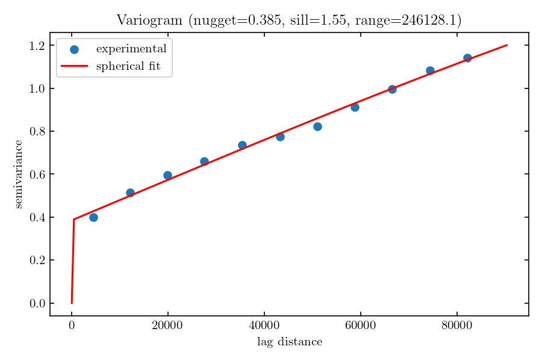

# Variogram calculation

Calculate and view experimental and model variograms
```python
import pandas as pd
import json
from sgs import (NormalScoreTransform, experimental_variogram, spherical,
		 exponential, gaussian_model, MODELS, fit_variogram,
		 man_variogram, _get_xy)


data = pd.read_csv('example.csv', comment='#')
x_col, y_col, value_col = 'X', 'Y', 'Bed'
x, y, x_label, y_label  = _get_xy(data, x_col, y_col)
values = data[value_col].to_numpy(dtype=float)

# Normal transform values -- essential for sGs
nst = NormalScoreTransform(values)  
g   = nst.forward(values)

lags, gamma, counts = experimental_variogram(x, y, g, n_lags=51)
x_ = np.linspace(0, lags.max() * 1.1, 201)

# Plot experimental and model variograms
plt.plot(lags, gamma, '.k', label='data')
for model_name in MODELS.keys():
    model = MODELS[model_name]
    pars  = fit_variogram(lags, gamma, model_name)
    pred  = model(x_, *pars.to_list()[1:])
    plt.plot(x_, pred, '-', label=model_name)

plt.legend()
plt.xlabel('Lags/[m]', fontsize='large')
plt.ylabel('Variogram/[-]', fontsize='large')
plt.show()
```

Save best choice of parameters to a json file
```python
best_model = 'spherical'  # choice: ('spherical'|'exponential'|'gaussian_model')
vp = fit_variogram(lags, gamma, best_model)

with open('params.json', 'w') as f:
    json.dump(vp.to_dict(), f)
```

Alternatively, hand-picked parameter values can be specified as
```python
vp = man_variogram(model_choice, nugget_choice, sill_choice, range_choice)

with open('params.json', 'w') as f:
    json.dump(vp.to_dict(), f)
```




# Run sGs calculation

Here, we will use the ```variogram_fit``` option to use the fitted variogram parameters.  
```bash
FILE=example.csv  # </path/to/data/>
PARS=params.json  # </path/to/params/file/>
X="X"		  # "Horizontal" coordinate (e.g. longitude)
Y="Y"		  # "Vertical" coordinate (e.g. latitude)
C="Bed"		  # Column containing values to interpolate
N=10		  # Run N realisations
J=-1		  # -1: Use all available processors
P="Example"	  # Prefix for output
RES=500		  # Resolution of sGs calculation, in grid units
python sgs.py $FILE -g $RES -j $J -x "$X" -y "$Y" -c "$C" -n $N -f $PARS -p $P
```

Please be aware that the supplied dataset is quite large (4878 rows), so running more than a few realisations can be very lengthy (computational complexity scales as O(N³) -- https://arxiv.org/abs/2602.03483)

## Key flags
| Option | Default | Meaning |
|---|---|---|
| -c/--data-col       | | column to interpolate (required)		      |
| -x/-y               | | coordinate columns (optional; default: derive from  |
|                     | |   geometry, auto-projecting to a local UTM CRS if   |
|                     | |   the data is in lon/lat degrees)                   |
| --group-by          | | optional column; run one independent SGS per group  |
|                     | |   (e.g. "year") instead of one run over everything  |
| -j/--n-jobs         | 1 | realisations to run in parallel: 1=sequential     |
|                     |   | (default), -1=all CPU cores, N = N cores          |
| -n/--n-realisations | 20 | total number of realisations                     |
| -g/--grid-res       | None |grid resolution (in UTM units/[m])              |
| -m/--max-neighbors  | 24 | max number of neighbouring values to use in kdir |
| -l/--n-lags         | 12 | number of lags			   	      |
| -v/--variogram-model| "spherical" | form of the variogram model  	      |
| -f/--variogram-fit  | None | path to fitted variogram parameters 	      |
| -s/--seed           | 42 | random seed value			   	      |
| -p/--prefix         | prefix to add before data and figures      	      |
| --min-points	      | 20 | skip a group if fewer valid points    	      |
